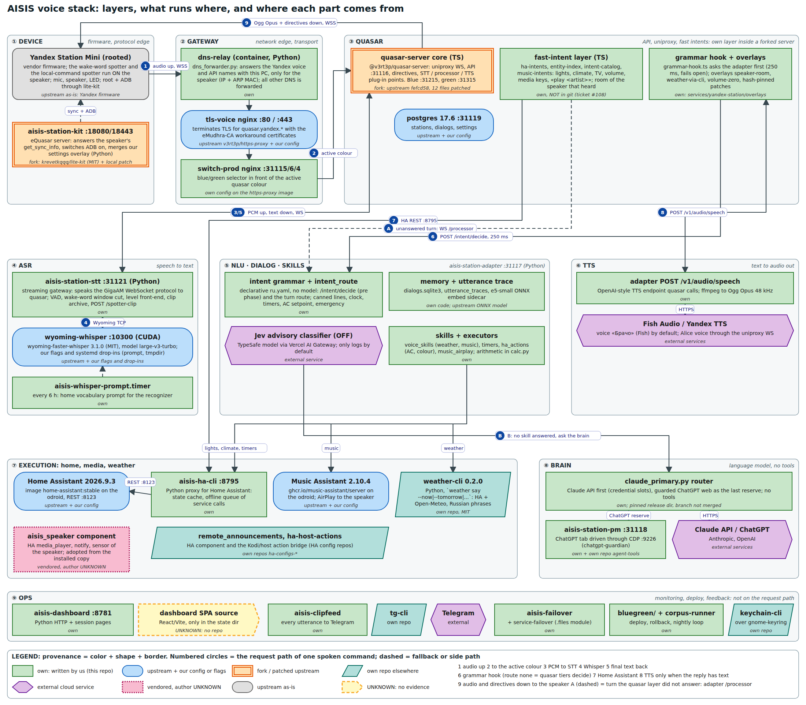
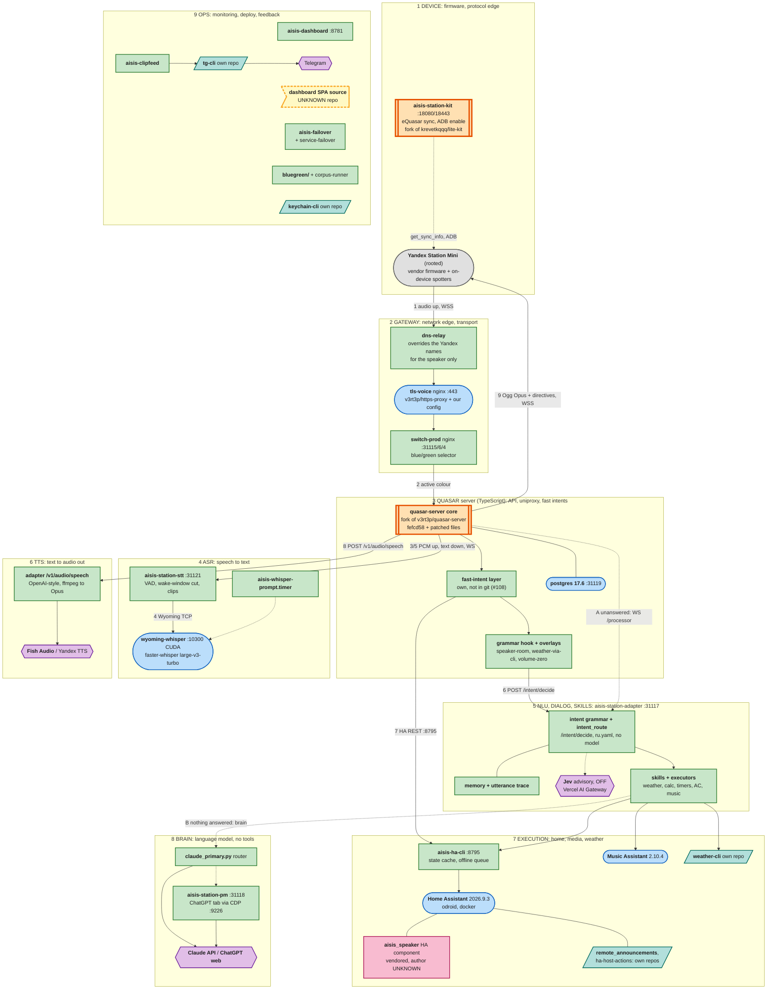
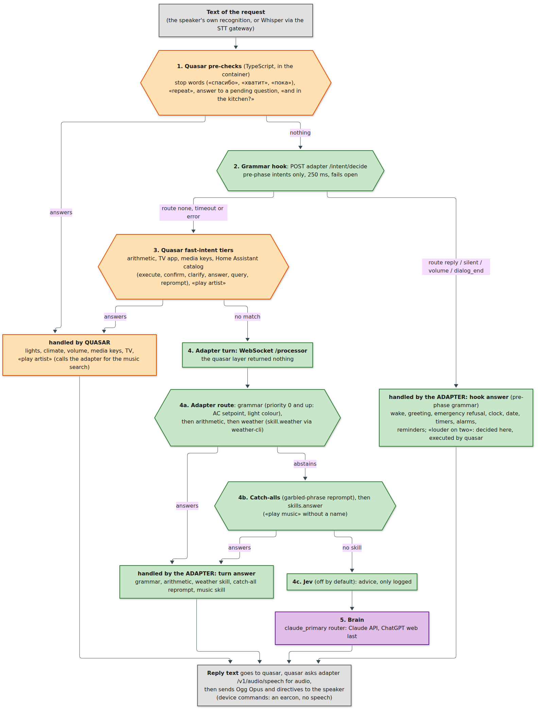
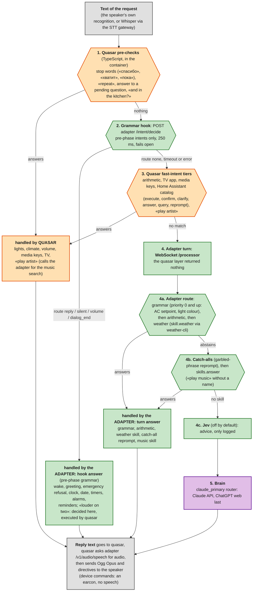

# Voice stack: layers, ownership and decision chain

What answers when someone speaks to the rooted Yandex Station Mini, which layer does what, and for every part: did we
write it, take it ready-made, fork it, or is its origin unknown. Facts below were checked on 2026-11-19 against the
running machines (container image layers, `package.json`, `LICENSE`, `git remote`/`git log` of the checkouts, pip
`METADATA`/`RECORD`, systemd units, the stored utterance traces and the quasar container log). Where a fact could not be
checked the text says `UNKNOWN` and the reason (see [What is unknown](#what-is-unknown)).

> **Not the design of spec 140.** [`docs/specs/140-local-voice-speaker.md`](../specs/140-local-voice-speaker.md) describes
> an older plan: a USB microphone array, `vad-cli`, `stt-lib` in-process and the `openclaw-speaker` channel plugin. None of
> that runs today: there is no `vad-cli` on the machine and the speaker is the rooted Station itself. What runs is the
> stack in `services/yandex-station/` documented here. [`repo-layout.md`](repo-layout.md) lists the live adapter under
> `services/yandex-station/` and marks the rest of its tree as a target layout.

## The picture

Vector original: [`voice-stack-layers.svg`](voice-stack-layers.svg), drawn by [`voice-stack-layers.gen.py`](voice-stack-layers.gen.py) (hand-laid-out;
the Mermaid block below is a simplified text form of the same graph without positions, kept as the editable source of the
node list). Regenerate: `python3 docs/architecture/voice-stack-layers.gen.py > docs/architecture/voice-stack-layers.svg`, rasterise with
headless Chrome at the SVG's width and height; the decision graph: `mmdc -i voice-stack-decision.mmd -o voice-stack-decision.png -s 2`.
When a number in the text changes (patched files, intent counts), update the generator too.

Numbered circles are the request path of one spoken command: **1** audio goes up to the server, **2** the active quasar
colour takes it, **3/5** PCM goes to the STT gateway and the final text comes back, **4** the gateway asks Whisper,
**6** the quasar grammar hook asks the adapter, **7** the quasar fast-intent layer acts on Home Assistant, **8** quasar
asks the adapter for speech, **9** Ogg Opus and directives go back to the speaker. **A** (dashed) is the fallback: a turn
the quasar layer did not answer goes to the adapter over `/processor`, and **B** is the adapter handing a turn it cannot
answer to the brain.

Colour legend (also drawn in the picture): green = own, written by us in this repository; teal = own repository elsewhere;
blue = upstream software with our configuration only; orange with a double border = fork or patched upstream; grey =
upstream as-is; purple = external cloud service; pink dotted = vendored, author unknown; yellow dashed = unknown.

## The words

- **Quasar** is Yandex's name for the server side the Station talks to: the `quasar.yandex.net` HTTP API plus the
  `uniproxy` WebSocket voice protocol. Here *quasar* means **our self-hosted emulator of that server**
  (`@v3rt3p/quasar-server`, "Quasar Server emulator"), running as a container in two colours (blue/green). The Station's
  Yandex cloud is not used for recognition or commands.
- **eQuasar** is a different, much smaller thing: `equasar_server.py` of the *lite-kit* project, which imitates Yandex's
  activation/sync endpoint (`get_sync_info`). It is how the Station was rooted (ADB switched on) and how it still receives
  its config. Unit `aisis-station-kit`, ports 18080/18443.
- **Adapter** (`aisis-station-adapter`, Python, port 31117) is our service that fills the plug-in points the quasar server
  already has: the *processor* backend (`PROCESSOR_BASIC_URL`, WebSocket `/processor`: "here is the recognised text, give
  me the reply"), the *TTS* backend (`TTS_OPENAI_BASE_URL`, an OpenAI-style `POST /v1/audio/speech`), plus HTTP endpoints
  we added for our overlays (`/intent/decide`, `/music/play`, `/music/control`, `/asr/correct`, `/laya`).
- **STT gateway** (`aisis-station-stt`, port 31121) fills the third plug-in point, `STT_GIGAAM_URL`: the quasar server
  streams PCM over a WebSocket in the GigaAM server's wire format and expects `{text, end_of_utt}` back. The gateway speaks
  that format to quasar and Wyoming to the recognizer.

So the three plug-in points the upstream server exposes (STT, processor, TTS) are all implemented by us, and the
*fast-intent layer* is code we added **inside** the quasar server in front of the processor.

## The nine layers in order

1. **Device.** The Station hears the wake word and its own short commands (the on-device spotters). A woken stream opens
   with about 2.3 s of audio the Station had buffered before its spotter fired. The Station mic, speaker, LED and clock are
   all it contributes. Commands the Station recognises itself arrive as text only; the recording next to them is
   forwarded to the gateway (`POST /spotter-clip`) for the archive.
2. **Gateway / transport.** The `dns-relay` container answers the Yandex voice and API names with this PC, only for the
   speaker's IP (checked against its ARP MAC); every other DNS query is forwarded unchanged. `tls-voice` terminates TLS with
   the workaround certificates; `switch-prod` forwards to whichever quasar colour is active, so a deploy flips colours
   without the Station noticing.
3. **Quasar.** Speaks the Station's protocols, owns the conversation state (postgres), runs the **fast-intent layer**
   (lights, climate, TV, volume, media keys, «включи <исполнитель>», arithmetic) and the grammar hook, and builds the
   directives the Station plays. Source of this layer and the overlays: see [Where quasar comes from](#where-quasar-comes-from).
4. **ASR.** Gateway: voice activity detection, the wake-word window cut (the recognizer never hears the activation name),
   a level front-end, a clip archive. Recognizer: Whisper large-v3-turbo on the GPU, primed with a home vocabulary prompt
   that a timer regenerates every 6 hours.
5. **NLU, dialog, skills.** The adapter's declarative grammar (`ru.yaml`, 56 intents, no model), arithmetic, the skills
   (weather through `weather-cli`, «включи музыку» without a name), timers and alarms, Home Assistant executors for what
   the quasar layer cannot parse (AC setpoints, colour), dialog memory, and one trace record per call. Jev is an optional
   advisory classifier, off by default.
6. **TTS.** The adapter synthesises every spoken reply, whoever decided it: voice «Брачо» through Fish Audio by default,
   the Alice voice through Yandex's uniproxy, SpeechKit optional; ffmpeg turns it into Ogg Opus.
7. **Execution.** `aisis-ha-cli` is the always-on proxy for Home Assistant (state cache, queue of calls while HA
   restarts). Home Assistant and Music Assistant run in docker on the odroid. `weather-cli` answers weather.
8. **Brain.** Only for what nothing else answered. No tools: it can talk, not act. The traces of 2026-11-18 show provider `claude`,
   model `claude-sonnet-5-5`; the ChatGPT web tab (driven through CDP by `aisis-station-pm`) is the reserve.
9. **Ops.** Dashboard, clip feed to Telegram (every heard utterance becomes a post, owner replies become ASR truth),
   watchdogs, blue/green deploy, the nightly intent loop. Not on the request path.

## The decision chain: who answers

A recognised phrase is tried in this order, and the first layer that has an answer wins. "Handled by the adapter" and
"handled by quasar" mean *which process produced the action or the text*; both sit **after** STT (they receive text) and
**before** TTS (they produce text; the adapter's `/v1/audio/speech` turns any reply text into audio, whichever layer
decided it). A device command such as a light switch ends with a short earcon and no speech.

The order is the code's, not a convention (`backend/ha-intents.ts` `matchFastIntentCore`, `code/adapter.py` `_process_turn`):

1. **Quasar pre-checks** run first: «хватит», «спасибо», «пока», «отмена» end the dialog (the adapter's `dialog.thanks` is therefore not what answers «спасибо»), «повтори» replays the last turn, an answer to
   a pending question («Да», «семь») is resolved, «а на кухне?» re-runs the previous command for the room in the phrase.
2. **The grammar hook** (overlay `intent-grammar`, `grammar-hook.ts`) POSTs the text to the adapter's `/intent/decide`
   with a 250 ms budget. The adapter classifies with its grammar in the **pre phase** only: 26 of the 56 intents. They are
   the phrases that must not wait for quasar's own handlers: noise the recogniser invents (captions, fillers), the wake
   word alone, greeting, the refusals (emergency, insults, politics, calls), the clock and the date,
   timers, alarms and reminders, relative volume with an amount («громче на два», «тише на 20 процентов») and negation («не включай свет»). It answers `reply`,
   `silent`, `volume` or `dialog_end` and runs the action itself, or says `none`. A timeout, an error or the switch
   `GRAMMAR_HOOK=off` also means `none`: **`none` hands the phrase back to quasar; it does not mean the phrase went
   unanswered.** The other 30 intents (lights, bare «громче»/«тише», absolute volume, media keys, AC setpoint, light colour, the garbled-phrase
   reprompt) are *post phase* (the counts are as of 2026-11-19; the nightly loop edits `ru.yaml`): the adapter reads them only in its own turn (step 4), after quasar found nothing.
3. **Quasar tiers** continue: arithmetic, TV application and fireplace scripts, media keys, then the Home Assistant
   catalog (exact match: execute; close match: «Ты про …?»; underspecified: ask a question; garbled: reprompt), then
   the music catalog (adapter `/music/play`, Music Assistant). The `weather-via-cli` overlay makes the entity lookup return
   "none" for the weather phrases in its table, so weather is not answered here.
4. **Adapter turn** (WebSocket `/processor`) only when quasar returned nothing. Order in `intent_route.py`: the grammar with all
   phases at priority 0 and up, then arithmetic, then weather (`skill.weather`), then the catch-alls (the garbled-phrase
   reprompt), then `skills.answer` («включи музыку»), then Jev (advice only), then the brain.
5. **Brain**: `claude_primary.py` (Claude API first, the ChatGPT web tab as the last reserve). It has no tools.

### Real traces

The adapter stores one record per call it was asked (`utterance_traces` in `dialogs.sqlite3`, PR #151). `via=hook` is the
`/intent/decide` question from quasar, `via=turn` is the `/processor` call. These are stored records from
2026-11-17..19, shortened; the quasar lines are from its container log of 2026-11-19.

| Phrase | Adapter trace | What it shows |
|---|---|---|
| «включи свет» | `via=hook layer=none` (stored, no further adapter record) | The adapter was asked and said `none` («not handled by the adapter»). The quasar log then shows the actual handling: `Fast intent room for 'включи свет': <room of the speaker>`, `Fast intent executed: on [light.…]`, `(executed, silent)`. **Handled by quasar.** |
| «Какая погода.» | `via=hook layer=none`, then `via=turn intent=skill.weather tier=query executor=skill.weather calls=[weather-cli "weather say --now" ok 331 ms] layer=skill` | Hook says `none` (weather is not a pre-phase intent, and the overlay stops quasar's own HA entity answer), quasar tiers find nothing, the adapter turn runs the grammar, which routes to the skill and `weather-cli`. **Handled by the adapter (skill).** |
| «Когда, ой, это самое, какая погода завтра?» | `via=hook layer=none`, then `via=turn layer=brain brain={provider: claude, model: claude-sonnet-5-5} stages_ms={brain: 1340, total: 1375}` | The filler words defeat the grammar, so the phrase fell to the brain, which has no weather tool and answered that it sees no forecast. **Handled by the brain**, and an observed gap: a phrase the grammar misses gets no skill. |
| «Громкость.» then «семь» | `intent=volume.slotless tier=clarify` («Какую громкость поставить?»), then `intent=volume.set executor=speaker.volume layer=error` | Stored 2026-11-17: the clarification came from the adapter's turn route, and the answer «семь» matched `volume.set`, whose executor belongs to quasar. The turn route declines such a decision, so the turn fell through to the brain, which then failed. This is a documented gap of the turn path (`intent_route.py`: "a turn that reaches the adapter with such a decision still goes to the brain"). Relative volume with an amount («громче на два») is a pre-phase intent: the hook returns `route=volume` and quasar executes it. A bare «громче» is a post-phase intent: the hook says `none` and quasar's own volume tier handles it. |
| «Малис.» (a recogniser's spelling of the wake word) | `via=hook-shadow intent=smalltalk.wake tier=canned layer=none` | In shadow mode the grammar only classifies. Live, the canned line is one of «Слушаю.», «Да?», «Я здесь.». |
| «Напомню, выключить грелку через десять минут.» | `via=hook-shadow intent=reminder.in tier=execute executor=timer.start slots={what: …, duration: 600}` | Shadow classification only; shows the timer route the grammar picks. |

### Six cases in words

- **A light command («включи свет»).** The device or the gateway turns it into text; the quasar pre-checks pass; the hook
  asks the adapter and gets `none`; the quasar HA catalog resolves device and room (the room is the HA area of the
  speaker that heard it), calls Home Assistant through `aisis-ha-cli` and the Station plays an earcon. If HA is restarting
  the answer is a spoken «Умный дом перезагружается …». The adapter only supplies speech when there is text to say.
- **A weather question.** Hook `none`; quasar tiers find nothing (by design, via the overlay); the `/processor` turn hits the
  grammar's `skill.weather`, the adapter runs `weather say --now|--tomorrow|--week|--umbrella|--dress` of `weather-cli`
  and speaks exactly what the CLI words. About 0.3 s, no model.
- **A free question for the brain.** Every earlier layer abstains; the adapter builds the persona block, dialog history and
  memories, asks the brain router (1 to 2.5 s) and speaks the answer. The brain cannot act, so it cannot do what the layers
  above exist for.
- **An emergency phrase («вызови скорую», «у нас пожар», «не могу дышать»).** The pre-phase grammar intent
  `refuse.emergency` (priority 1000, the highest) answers through the hook: the speaker says it cannot call anyone and to
  dial 112 right now (plus the Serbian emergency numbers). It never goes to a model. A second, independent guard
  (`jev.is_emergency`) stops these phrases reaching Jev. A must-pass safety set in the grammar's back-test pins the phrases;
  a miss fails the nightly gate. No live trace of an emergency exists in the stored traces: this is read from the grammar
  and its tests, not observed.
- **A timer or a reminder.** The pre-phase intents `timer.set`, `alarm.set` and `reminder.in` are decided by the grammar
  and run by the adapter's `TimerBook` (persisted JSON, announced through a Home Assistant TTS entity and player), with the
  reply «Таймер на …» or «Напомню через …». Timers work only when the adapter is configured with that TTS entity and
  player; without them the answer is «Таймеры и будильники я пока не умею.» Whether the live adapter has them configured is
  `UNKNOWN` (its environment was not read).
- **The wake word alone.** On the device the spotter fires. The gateway's wake-window cut removes the name from the audio; a
  name the window could not locate (a pause of more than 0.8 s behind it makes the VAD cut it as an utterance of its own) is
  taken by its place: a short utterance that ended inside the station's pre-trigger history is the name. When what remains is
  only the name (or Whisper wrote it as «Алиса.», «Малис.»), it is an **activation event**: no final
  goes to quasar, the session keeps listening, and the clip is archived with `status='activation'`. If the text does reach
  the grammar, `smalltalk.wake` answers with a canned «Слушаю.»

## Where quasar comes from

Evidence, in order of strength:

- The container's `package.json`: `"name": "@v3rt3p/quasar-server"`, `"description": "Quasar Server emulator"`,
  `"author": "radioegor146"`, `"license": "MIT"`; `README.md`: «Emulator of Yandex.Station Quasar backend server»;
  `.gitmodules`: submodule `protos` from `github.com/v3rt3p/quasar-protos`; `Dockerfile`: `FROM node:25`, pnpm 10.23.0,
  `CMD ["pnpm", "start"]` (`tsx src/main.ts`).
- The upstream is the public repository **`github.com/v3rt3p/quasar-server`** (default branch `master`, not a fork). Its
  commits are authored by Egor Koleda. The `LICENSE` file shipped in the repository and in our image is the **GNU GPL v3**
  text, added upstream on 2026-10-21 (`add: license`), and GitHub reports `GPL-3.0`, while `package.json` still says
  `MIT`. Upstream is inconsistent on its own; which one governs is `UNKNOWN`.
- A local checkout of the upstream exists in the cache directory (origin `v3rt3p/quasar-server`, at `a983cda`, 2026-10-21).
  The first image, `aisis-quasar:a983cda` (2026-10-23), has the same 26 source files as that commit, 9 of them already patched by us (17 byte-identical).
- How the image evolved (from `docker image inspect` creation times and file hashes, 2026-11-19):

  | Image | Created | What its `/src` is |
  |---|---|---|
  | `aisis-quasar:a983cda` | 2026-10-23 | upstream commit `a983cda` (26 files, 17 byte-identical, 9 patched by us); none of the fast-intent files |
  | `aisis-quasar:upstream-20261106` | 2026-11-06 17:01 | upstream tree at commit `fefcd58` (2026-11-04): same 39-file set, 29 files byte-identical, 10 patched by us |
  | `aisis-quasar:upstream-20261106b` | 2026-11-06 22:20 | first image with `backend/ha-intents.ts` (519 lines): the fast-intent layer appears here |
  | `aisis-quasar:restore-20261107` | 2026-11-07 | `ha-intents.ts` 879 lines |
  | active colour on 2026-11-19 (`volume-zero-e859a37b`) | 2026-11-18 | `ha-intents.ts` 1464 lines, grammar hook, overlays |

  Each deploy `COPY`s a whole `/src` directory into a new layer on top of the upstream base layers
  (`pnpm install --frozen-lockfile` from upstream's `package.json` and lockfile).
- The active colour on 2026-11-19 against upstream `fefcd58` (63 source files, `protos` and fillers excluded): **27 byte-identical,
  12 modified by us, 24 added by us** (21 TypeScript/MJS files, about 6,050 lines, mostly `backend/*`; the rest are corpus
  data and config). Upstream's `master` on 2026-11-19 (last commit 2026-11-15, `0a359df`) is newer than any image: it has no
  `ha-intents.ts`, `entity-index.ts`, `intent-catalog.ts`, `music-intents.ts` or `grammar-hook.ts`, so these are not
  upstream code.

What is whose:

| Part of the quasar container | Origin | Notes |
|---|---|---|
| uniproxy WebSocket, `quasar.yandex.net` API, protobuf, directives, processor/STT/TTS/music plug-in points, storage | upstream `v3rt3p/quasar-server` @ `fefcd58`, unmodified (27 files) | |
| the patched files | fork: ours on top of upstream | STT stream finalisation (`gigaam.ts`), Ogg/Opus hardening (`opus-processor.ts`, `ogg-parser.ts`, `buffered.ts`), `voice-input-handler.ts`, the uniproxy path (a missing device id closes the socket; no client is authenticated until `overlays/quasar-admission`, ticket #202), Sentry telemetry switched off ("do not ship voice transcripts to a placeholder DSN"), API bound to loopback (hence `aisis-station-lan-proxy`, which forwards only for `ALLOWED_PEERS`), hook points for the fast-intent layer and spotter clips in `uniproxy-connection.ts` / `input-handler.ts` |
| fast-intent layer: `ha-intents.ts`, `entity-index.ts`, `intent-catalog.ts`, `music-intents.ts`, `fuzzy-ru.ts`, `tv-app-intents.ts`, `settings-voice.ts`, `turn-memory.ts`, `end-dialog.ts`, `asr-correct.ts`, … | **own**, AISIS-specific by content (`AISIS_*` variables, the home's entity map, the owner's confirmations) | Had **no git history** (ticket #108): first seen in the 2026-11-06 22:20 image. Its history is now reconstructed in the published fork `alex-mextner/aisis-quasar` from the images: one commit per image, dated by the image build date, not by when it was written. Who wrote it and when is `UNKNOWN` beyond that. |
| `overlays/speaker-room`, `weather-via-cli`, `intent-grammar`, `volume-zero` | own, in this repository | Each has `prepare_overlay.py` that takes the exact production sources from the running image (`docker cp`), **refuses a source whose SHA-256 differs from the one the patch was reviewed against**, applies the patch/new files and writes an overlay directory that `bluegreen/deploy.sh deploy --overlay` ships. |
| `grammar-hook.ts` | own, in `overlays/intent-grammar` | |
| corpus runner (`backend/corpus/*`) | own, versioned in `services/yandex-station/corpus-runner/` | |

Overlay changes in quasar: **speaker-room** (a phrase without a room acts in the room of the speaker that heard
it; spotter clips are forwarded to the gateway), **weather-via-cli** (the weather and outdoor-temperature phrases of a table
are not answered from the HA weather entity, so they reach the adapter and `weather-cli`), **intent-grammar** (ask the
adapter grammar first), **volume-zero** (the set-volume directive accepts 0, range 0..10, so a silenced speaker can be
restored).

## Provenance table

`Level` is the layer of the diagram. "Own" means written by us in this repository (commits by *Alex Ultra* and *alex-mextner*
in `git log`); "own repo elsewhere" is the owner's other repository.

| Component | Level | Runtime, process, port | Called by → calls | Provenance | Evidence |
|---|---|---|---|---|---|
| Yandex Station Mini (rooted) | device | vendor firmware | ↔ quasar (WSS uniproxy); ← kit (sync) | **upstream as-is** (Yandex firmware; root through lite-kit) | lite-kit README; the firmware build is `UNKNOWN` (not read) |
| aisis-station-kit | device protocol edge | Python 3, `equasar_server.py`, user unit, :18080/:18443 | ← Station; reads our settings overlay | **fork/patched**: upstream `krevetkqqq/lite-kit` (MIT, HEAD `8a82ff3`) plus a local patch to `scripts/equasar_server.py` (+65/−4: injects the local command spotters, merges the dashboard overlay, no outgoing requests to Yandex), published as the patch series [`alex-mextner/aisis-station-kit`](https://github.com/alex-mextner/aisis-station-kit) (branch `patches`) with an apply script | `LICENSE`, `git remote`, `git diff --stat` in the checkout |
| dns-relay | gateway | Python 3.12 alpine container `…-dns-relay-1`, `dns_forwarder.py` | ← Station DNS → upstream resolvers | **own** (source in a release directory of the unmerged branch `aisis-network-recover`, not in `main`) | file docstring, mounts, `git branch --contains` |
| tls-voice | gateway | nginx container (image `aisis-yandex-https:3b902d6`), :80/:443 | ← Station → switch | **upstream + our config**: `v3rt3p/https-proxy` (GPL-3.0) at `3b902d6` (author Egor Koleda); the cache checkout it is built from is clean at that commit. A second checkout of the same project has an uncommitted `generate.sh` change and local certificates; whether that change reached the running image is `UNKNOWN` | `git remote`, `git status` of both checkouts |
| switch-prod | gateway | nginx container (same image), :31115/:31116/:31114 | ← tls-voice → active colour | **own** configuration on that image | `bluegreen/compose.bluegreen.yaml` |
| quasar-server (blue :31215.., green :31315..) | quasar | TypeScript, Node 25, image `aisis-quasar:*`, API :31116 | ← switch; → STT :31121, adapter :31117, ha-cli :8795, postgres :31119 | **fork/patched** upstream plus an **own** fast-intent layer and overlays; the sources are published as [`alex-mextner/aisis-quasar`](https://github.com/alex-mextner/aisis-quasar) (tag per deployed image; the active image's `/src` was compared with tag `aisis-volume-zero-e859a37b` and is identical, 2026-11-19; deploys still go through the overlays) | see [Where quasar comes from](#where-quasar-comes-from) |
| postgres | quasar | `postgres:17.6-bookworm`, 127.0.0.1:31119 | ← quasar | **upstream + our config** | `compose.yaml` |
| aisis-station-lan-proxy | gateway | Python, TCP proxy LAN:31116 → 127.0.0.1:31116 | ← the HA `aisis_speaker` component → quasar API | **own** | `quasar_lan_proxy.py` |
| aisis-station-stt | ASR (gateway) | Python, aiohttp, :31121; libs `webrtcvad-wheels` (VAD), `aiohttp`, `imageio-ffmpeg` | ← quasar (WS, GigaAM format) → Wyoming; `POST /spotter-clip` ← quasar | **own** | `code/stt_wyoming.py`, `wake_window.py`, `requirements.txt` |
| wyoming-whisper | ASR | `wyoming-faster-whisper` 3.1.0 (MIT) with `wyoming` 1.9.0, `faster-whisper` 1.2.1, `ctranslate2` 4.7.1; model `large-v3-turbo` (`mobiuslabsgmbh/faster-whisper-large-v3-turbo`), CUDA, :10300 on the tailnet address | ← STT gateway | **upstream + our flags and systemd drop-ins** (initial prompt, temp directory, restart policy); installed package files match the wheel's `RECORD` hashes (18 of 18), so no patch | pip `METADATA`/`RECORD`, `systemd/wyoming-whisper.service.d/` |
| aisis-whisper-prompt.timer | ASR | systemd timer → `refresh-whisper-prompt.sh` / `voice_vocab.py` | → HA, library | **own** | `systemd/` |
| aisis-station-adapter | NLU / dialog / TTS | Python, aiohttp, :31117 (`/processor`, `/intent/decide`, `/v1/audio/speech`, `/music/*`, `/asr/correct`, `/laya`) | ← quasar; → ha-cli, pm, weather-cli, Music Assistant, TTS clouds | **own** (`adapter.py`, `intent_route.py`, `intent_grammar/`, `voice_skills.py`, `ha_actions.py`, `timers.py`, `utterance_trace.py`, `memory.py`) | `git log`, files |
| intent grammar | NLU | `intent_grammar/` (`ru.yaml`, 56 intents, 26 pre-phase) | ← adapter | **own** | files |
| aisis-station-embed | dialog memory | Python, `embed_server.py`, multilingual-e5-small ONNX, loopback | ← adapter | **own code; upstream model** (licence of the model not checked here) | docstring |
| Jev | NLU (advisory) | HTTPS to Vercel AI Gateway, `AISIS_JEV` default `off` | ← adapter | **external service** (TypeSafe's decision model) | `jev.py`, README |
| weather-cli | execution | Python 0.2.0 (MIT) CLI `weather` | ← adapter skills → HA (via ha-cli), Open-Meteo | **own repo elsewhere** (`alex-mextner/weather-cli`) | `pyproject.toml`, `LICENSE`, `git remote` |
| aisis-ha-cli | execution | Python, :8795 | ← quasar, adapter, weather-cli → Home Assistant REST | **own** | `hacli.py` |
| Home Assistant | execution | docker `ghcr.io/home-assistant/home-assistant:stable`, 2026.9.3, odroid :8123 | ← ha-cli | **upstream + our config** (config in the owner's `ha-configs-*` repositories) | compose file, `/api/config` |
| Music Assistant | execution | docker `ghcr.io/music-assistant/server:2.10.4` (digest pinned), odroid, AirPlay provider | ← adapter, HA | **upstream + our config** | compose file |
| `aisis_speaker` HA component | execution | HA custom component 1.0.1 | ← HA → quasar API through the LAN proxy | **vendored, author UNKNOWN**: adopted on 2026-11-19 from the installed copy, no licence or author notice, now maintained in `services/yandex-station/homeassistant/` | `homeassistant/README.md`, `baseline-provenance.json` |
| `remote_announcements`, `ha-host-actions` (Kodi bridge) | execution | HA custom component; a user service on the odroid | ← HA | **own repo elsewhere** (`ha-configs-*`; codeowner `@alex-mextner`) | component `manifest.json`, git history of the HA config repository |
| adapter TTS endpoint + ffmpeg | TTS | in the adapter | ← quasar | **own** (+ upstream `ffmpeg`) | `adapter.py` |
| Fish Audio, Yandex uniproxy TTS, SpeechKit | TTS | HTTPS / WSS | ← adapter | **external services** (the Alice voice through uniproxy uses Yandex's public developer key; SpeechKit is optional) | `adapter.py`, `uniproxy_tts.py` |
| `claude_primary.py` | brain | Python JSON command, release directory `claude-primary-<sha>` | ← adapter → Anthropic API, then `aisis-station-pm` | **own**, lives in the unmerged branch `feat/claude-primary-api` and in pinned release directories, not in `main` | release dir, `git branch --contains` |
| aisis-station-pm | brain | Python, :31118, drives a ChatGPT tab through CDP :9226 | ← brain router → ChatGPT web | **own**, runs from the `chatgpt-guardian` venv of the owner's `agent-tools` repository | unit file |
| Claude API, ChatGPT web | brain | HTTPS | ← brain router | **external services** | `claude_primary.py`, traces |
| aisis-dashboard | ops | Python, :8781; SPA `aisis-dashboard-ui` 1.0.0 (React/Vite) | ← owner | **own** server; the SPA source is **`UNKNOWN`** (found only in the runtime state directory, no repository) | `dashboard.py`, `package.json` |
| aisis-clipfeed | ops | Python, systemd | → `tg` → Telegram | **own** | `clipfeed.py` |
| tg-cli | ops | CLI `tg` | ← clipfeed | **own repo elsewhere** | `git remote` |
| aisis-failover; `service-failover` module | ops | Python watchdog; module of the `.files` repository (`ubuntu/modules/service-failover`) | → systemd, docker | **own**; own repo elsewhere (`.files`) | files |
| bluegreen/, corpus-runner/, nightly intent loop | ops | bash/Python | → docker, quasar, adapter | **own** | files |
| keychain-cli, gnome-keyring | ops | CLI; `gnome-keyring-daemon` | secrets for the services | **own repo elsewhere**; **upstream as-is** | `keychain --version` 0.3.2, `/usr/bin` |
| `stt-cli` / `stt-lib` | ops | Python library | only the dashboard's vocabulary page imports its dictionary manager (`dashboard_dicts.py`) | **own repo elsewhere** (`stt-cli`), **not on the request path** | imports |
| OpenClaw gateway container | outside | `ghcr.io/openclaw/openclaw:latest`, :18789 | the dashboard probes it | **upstream + config**, **not on the voice path** | `docker ps`, `dashboard.py` |

## What is unknown

- **Who wrote the fast-intent layer and when.** It had no git history (ticket #108); the images show it first
  on 2026-11-06 22:20 and growing since, and the published fork's commit dates are image build dates. Its content is AISIS-specific, so it is treated as own.
- **Quasar's licence.** `package.json` says MIT, the shipped `LICENSE` is GPL-3.0 and GitHub reports GPL-3.0. Which governs,
  and what that means for our patches, is not decided here.
- **Local patches that exist only in working copies:** an uncommitted `generate.sh` in the second https-proxy checkout. A rebuilt machine would lose it. (The lite-kit patch and the quasar sources are now published, see the table.)
- **Sources outside `main`:** `dns_forwarder.py` (release directory of branch `aisis-network-recover`), `claude_primary.py`
  (branch `feat/claude-primary-api`, pinned release directories), the dashboard SPA (state directory only).
- **Original author and licence of `aisis_speaker`:** the installed copy carried none; the repository states it does not
  infer one.
- **The live brain command and timer configuration:** the adapter's environment was deliberately not read. The traces show
  `provider=claude`; whether the ChatGPT reserve still works, and whether timers are enabled, was not observed.
- **Station firmware build and anything on the device beyond root/ADB** was not inspected.
- **Licences/origins not checked:** the e5-small and speaker-verification ONNX models, the HACS `yandex_station` integration
  on the odroid, the odroid's `ma-local-audio` image, Fish Audio's «Брачо» voice.
- **No live trace** of an emergency phrase, a timer in `on` mode, or an activation-only turn exists in the stored traces
  (27 records); those three cases above come from the code and its tests.
